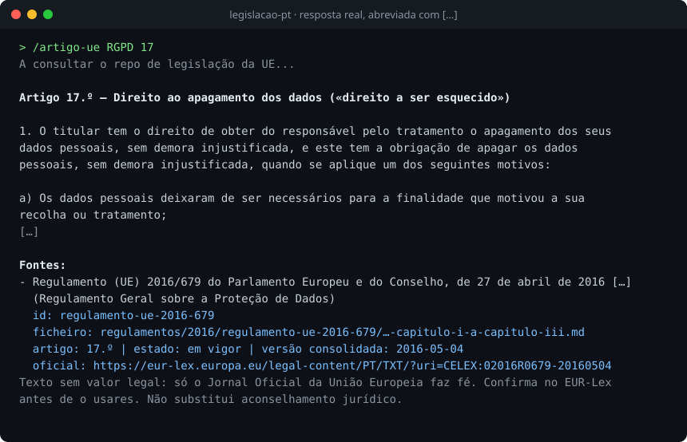

# legislacao-pt

Plugin do Claude Code que consulta a legislação portuguesa e a legislação da União Europeia em português e cita sempre a fonte
oficial. Responde só com o que está nos repositórios públicos e nunca de memória: se não encontra, diz "Não encontrado no repo."

Serve a quem precisa de ter a certeza de que o artigo que lê é o que está em vigor e de saber de onde vem: juristas,
investigadores e quem constrói agentes de IA.



Só precisas de instalar este plugin. Os dados não se instalam: o plugin lê-os pela internet dos repositórios
[LawAgents/pt](https://github.com/LawAgents/pt) e [LawAgents/ue-pt](https://github.com/LawAgents/ue-pt), que se atualizam sozinhos
todos os domingos.

> [!IMPORTANT]
> Os textos não têm valor legal. Na lei portuguesa a confirmação final é no Diário da República, e na da UE só o Jornal Oficial da
> União Europeia faz fé (EUR-Lex). Cada resposta traz a ligação oficial e o aviso. Não substitui aconselhamento jurídico.

---

## Como instalar

1. No Claude Code, escreve `/plugin marketplace add LawAgents/legislacao-pt-plugin` e carrega em Enter.
2. Escreve `/plugin install legislacao-pt@legislacao-pt` e carrega em Enter.
3. Reinicia a sessão e experimenta `/lei Código Civil` ou `/artigo-ue RGPD 17`.

Se já tinhas o plugin, atualiza-o em vez de instalares outro: a versão 0.2.0 acrescentou os três comandos da UE.

---

## Comandos

Legislação portuguesa, lida em [LawAgents/pt](https://github.com/LawAgents/pt):

| Comando | O que devolve |
| --- | --- |
| `/lei [nome ou sigla do diploma]` | A ficha do diploma: título, estado, data da versão consolidada, sumário, estrutura por livros, títulos e capítulos, e as fontes. O texto inteiro só se o pedires, depois de um aviso do tamanho. |
| `/artigo [diploma] [número do artigo]` | O texto do artigo (`483`, `483.º`, `483.º-A`), com as fontes. Trata artigos revogados e números que não existem. |
| `/pesquisar-lei [palavras]` | Até cinco diplomas encontrados no índice (títulos, nomes comuns, siglas, sumários e temas). Não pesquisa o texto das leis. |

Legislação da União Europeia, lida em [LawAgents/ue-pt](https://github.com/LawAgents/ue-pt):

| Comando | O que devolve |
| --- | --- |
| `/lei-ue [nome, sigla ou número do ato]` | A ficha do ato: título, estado, versão consolidada ou original, estrutura por capítulos e anexos e, nas diretivas, as leis portuguesas de transposição. |
| `/artigo-ue [ato] [número do artigo]` | O texto do artigo, palavra por palavra, com as fontes. |
| `/pesquisar-ue [palavras]` | Até cinco atos encontrados nos índices, com as fontes. |

Exemplos: `/lei Código Civil`, `/artigo Código Civil 483`, `/pesquisar-lei arrendamento urbano`, `/lei-ue RGPD`,
`/artigo-ue Regulamento da IA 5`, `/pesquisar-ue proteção de dados`.

---

## O que cobre

| Repositório | Conteúdo | Atos |
| --- | --- | ---: |
| [LawAgents/pt](https://github.com/LawAgents/pt) | Legislação portuguesa em vigor que o Diário da República disponibiliza consolidada, mais os originais nunca alterados e uma lista escolhida de diplomas sem consolidação | 4.987 |
| [LawAgents/ue-pt](https://github.com/LawAgents/ue-pt) | Regulamentos de base e diretivas da UE em vigor, em português | 5.439 |

Contagens de 2026-10-22. Os diplomas sem consolidação (por exemplo o Decreto-Lei 84/2021) trazem o aviso "Texto original, sem consolidação: pode ter sido alterado depois." Ficam de fora: jurisprudência, regulamentos municipais, e na UE os atos delegados e de execução, as
decisões e os tratados. Onde a UE só tem o texto original, a resposta avisa que "pode ter sido alterado depois".

---

## Como responde

Cada resposta com legislação termina com o bloco `Fontes:` e a linha de aviso:

```
Fontes:
- <título completo do ato>
  id: regulamento-ue-2016-679
  ficheiro: regulamentos/2016/regulamento-ue-2016-679/<parte>.md
  artigo: 17.º | estado: em vigor | versão consolidada: 2016-05-04
  oficial: https://eur-lex.europa.eu/legal-content/PT/TXT/?uri=CELEX:02016R0679-20160504
Texto sem valor legal: só o Jornal Oficial da União Europeia faz fé. Confirma no EUR-Lex antes de o usares. Não substitui aconselhamento jurídico.
```

Nas respostas portuguesas o bloco traz a ligação do Diário da República e a linha "Texto consolidado sem valor legal. Confirma no
Diário da República antes de o usares. Não substitui aconselhamento jurídico." Sem argumento, os comandos mostram como se usam. Se o
GitHub não responder, dizem-no e não respondem de memória.

---

## Estrutura

```
.claude-plugin/plugin.json          nome, versão e descrição do plugin
.claude-plugin/marketplace.json     o catálogo para /plugin marketplace add
commands/lei.md  artigo.md  pesquisar-lei.md        comandos da legislação portuguesa
commands/lei-ue.md  artigo-ue.md  pesquisar-ue.md   comandos da legislação da UE
skills/legislacao-pt/SKILL.md       regras de citação para qualquer pergunta sobre legislação
docs/exemplo-artigo-ue.svg          a imagem deste README
LICENSE                             MIT
```

Cada comando é um ficheiro de texto com as instruções e as pesquisas que o Claude segue. Não há código a instalar.

---

## Privacidade

- O plugin não escreve ficheiros no teu computador, não guarda registos e não tem contas.
- Só lê ficheiros públicos em `raw.githubusercontent.com/LawAgents/pt` e `raw.githubusercontent.com/LawAgents/ue-pt`, com `curl` em
  modo de leitura (e `awk`, `grep` e `sed` para escolher o trecho). Não contacta mais nenhum serviço.
- A tua pergunta não vai no endereço: o plugin só pede ficheiros por caminhos que vêm dos índices. Do que escreves, só o número do
  artigo e as palavras da pesquisa são usados, localmente, para escolher o trecho do ficheiro.
- Os comandos pedem permissão só para `curl`, `awk`, `grep`, `sed`, `head` e `tail`. As ferramentas de escrita e de pesquisa na web
  ficam desligadas nos comandos.

---

## Licença

MIT (ver `LICENSE`). Os textos legislativos são atos oficiais do Diário da República e do Serviço de Publicações da UE e não recebem
licença própria deste repositório.
